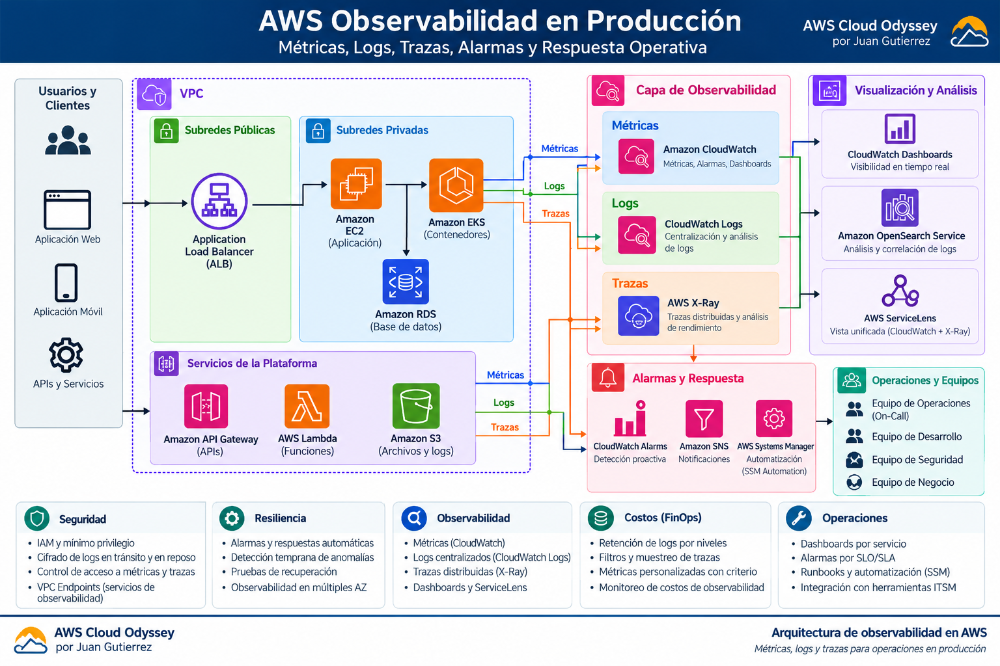

# 08 · Observing the Cloud: production observability on AWS

**Author:** Juan Gutierrez · AWS Production Architecture Series

> Observability is not about collecting every log. It is about detecting degradation, explaining why it happened, and restoring service before business objectives are breached.

## Scenario and requirements

A platform built on an Application Load Balancer, Amazon EKS/EC2, Lambda and Amazon RDS must answer: which service is failing, since when, who is affected, and what changed? Design around metrics, structured logs, distributed traces, clear service ownership and service-level objectives.

**Illustrative targets (tune to actual workloads):** 99.9% monthly availability, critical API p95 latency below 500 ms, HTTP 5xx rate below 1%, and actionable incident alerts.

## Reference architecture



CloudWatch provides native infrastructure and application metrics. CloudWatch Logs centralizes structured events; X-Ray or OpenTelemetry traces help correlate calls across dependencies. CloudWatch alarms notify SNS, optionally triggering controlled automation.

## Architecture decisions and trade-offs

| Decision | Benefit | Trade-off |
|---|---|---|
| CloudWatch as the first operational plane | Native integration, fewer components | Custom metrics, ingestion, queries and retention cost money |
| OpenTelemetry instrumentation | Portable context propagation | Requires disciplined sampling, attributes and collector management |
| SLI/SLO-based alerting | Reduces alert fatigue | Needs baseline and business agreement |
| Distributed tracing | Identifies slow dependencies | Sampling may miss rare events |
| OpenSearch only when justified | Flexible search and analytics | Additional operations and cost |

For Kubernetes-intensive teams, Amazon Managed Service for Prometheus and Amazon Managed Grafana may be appropriate. Avoid duplicating every signal across platforms.

## Security and privacy

- Enforce least-privilege IAM roles; separate read-only observability from alarm management and incident automation.
- Never log credentials, authorization headers, secrets or sensitive customer payloads.
- Set explicit log retention, encryption and access policies; check data residency requirements.
- Secure collectors and use private connectivity where justified.

## Reliability and incident operations

1. Alert on user-visible symptoms: error rate, latency, availability and saturation.
2. Attach service, environment, owner, affected SLO, dashboard and runbook to every actionable alert.
3. During incidents: scope impact → inspect metrics → correlate structured logs by trace ID → inspect traces → compare recent releases.
4. Exercise failure scenarios, dependency outages and recovery; confirm telemetry still works when the service is impaired.

## Observability FinOps

Choose retention by signal class (e.g., 7/30/90 days based on compliance and operational need), avoid high-cardinality labels, sample traces, filter low-value events, and track ingestion, storage, query and custom-metric costs. Never remove critical signals solely to cut spend.

## Deployable Terraform example

The [terraform](./terraform/) folder provisions a CloudWatch log group with retention and an ALB HTTP 5xx alarm. Supply a real ALB ARN suffix and an existing SNS topic. It does **not** deploy EKS or alter production workloads.

```bash
cd terraform
terraform init
terraform validate
terraform plan -var='alb_arn_suffix=app/my-alb/1234567890abcdef' -var='alarm_sns_topic_arn=arn:aws:sns:us-east-1:123456789012:ops-alerts'
```

**Risk:** review IAM permissions and the Terraform plan before applying. Tune the alarm threshold to request volume; low-volume services often need rates and longer evaluation windows.

## Production readiness checklist

- [ ] Business-approved SLIs and SLOs
- [ ] Correlation IDs and structured logs without secrets
- [ ] Service- and environment-specific dashboards
- [ ] Actionable alarms, ownership and runbooks
- [ ] SNS delivery and escalation tested
- [ ] Retention, encryption, access and budgets reviewed
- [ ] Game day and incident postmortem process established

## Official AWS references

- [Amazon CloudWatch](https://docs.aws.amazon.com/AmazonCloudWatch/latest/monitoring/WhatIsCloudWatch.html)
- [CloudWatch alarms](https://docs.aws.amazon.com/AmazonCloudWatch/latest/monitoring/AlarmThatSendsEmail.html)
- [CloudWatch Logs retention](https://docs.aws.amazon.com/AmazonCloudWatch/latest/logs/Working-with-log-groups-and-streams.html)
- [AWS X-Ray](https://docs.aws.amazon.com/xray/latest/devguide/aws-xray.html)
- [AWS Well-Architected Operational Excellence](https://docs.aws.amazon.com/wellarchitected/latest/operational-excellence-pillar/welcome.html)

---

*Production AWS architecture series · Juan Gutierrez.*
