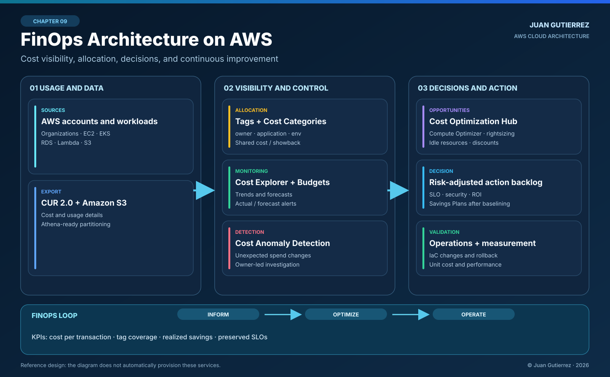

# 09 · Architecture with FinOps: optimize cloud cost without compromising production

**Author:** Juan Gutierrez · AWS Production Architecture Series  
**Focus:** financial visibility, cost accountability, technical decisions, and continuous improvement on AWS.

> An efficient architecture is not necessarily the cheapest one. It delivers the expected business value and service levels with measurable, explainable resource consumption.

## 1. Scenario: a growing AWS bill is not a root cause

Consider a digital platform using separate AWS accounts for production, nonproduction, and shared services. **Amazon EKS** runs the application, **Amazon RDS** stores transactional data, **Amazon S3** holds objects, and **Amazon CloudFront** distributes content. Traffic is growing, but so are compute, transfer, observability, and storage costs.

Finance asks why the bill increased; engineering points to higher traffic. **Both teams need a common measure:** the cost of a successful transaction while preserving availability, latency, security, and recoverability.

Optimizing a billing line item in isolation is dangerous. Removing capacity or shortening data retention can appear to save money while causing incidents, data loss, or compliance failures.

### Requirements and acceptance criteria

| Dimension | Design requirement | Validation |
|---|---|---|
| Transparency | Allocate costs to products, teams, environments, and accounts | Allocation coverage and unallocated percentage |
| Efficiency | Measure USD per 1,000 completed transactions | Same accounting period for cost and workload volume |
| Control | Detect overspend and reach accountable owners | Tested budget and anomaly notifications |
| Reliability | Preserve SLOs, RTO/RPO, and peak capacity | Load tests and latency/error review |
| Security | Restrict access to billing and reporting data | IAM, encryption, audit trail, and role-based access |
| Operations | Turn recommendations into reversible changes | Backlog, owner, rollback plan, and evidence |

Business owners set numeric targets. There is no universal savings percentage worth violating a service-level objective.

## 2. Reference architecture



**How to read it:** AWS accounts and workloads generate consumption. **AWS Data Exports (CUR 2.0)** delivers detailed records to **Amazon S3** for analysis, for example through **Amazon Athena**. Activated allocation tags, cost categories, and account boundaries make ownership visible. **AWS Cost Explorer**, **AWS Budgets**, and **AWS Cost Anomaly Detection** provide reporting and control signals. **Cost Optimization Hub** and **AWS Compute Optimizer** feed an engineering backlog; teams apply approved changes through IaC, verify SLOs, and measure again.

This is a **financial governance and analytics architecture**, not the application's request path and not an automatic deployment of every service shown.

### Three implementation decisions

**A. Inform:** enable Cost Explorer, define allocation dimensions, activate the relevant tags, and configure CUR 2.0 with Data Exports. Choose granularity and columns according to the business question: resource IDs and EKS/ECS split allocation increase export volume. Exports are not real time; every dashboard needs a visible data-freshness timestamp.

**B. Optimize:** prioritize capacity, idle resources, data transfer, and commitment discounts. Combine utilization, peak patterns, existing commitments, and total cost. **A savings recommendation is a hypothesis to validate**, not an instruction to change production immediately.

**C. Operate:** every action needs an owner, approved change window, tests, before/after measurement, and rollback. Review **realized** versus **estimated** savings monthly; a forecast is not cash already saved.

## 3. Allocation model: who spends and who owns the decision?

Use AWS Organizations accounts to separate environments and consistently tag supported resources:

| Tag | Example | Purpose |
|---|---|---|
| `application` | `customer-portal` | Product or service |
| `environment` | `prod` | Environment boundary |
| `owner` | `platform` | Accountable engineering owner |
| `cost-center` | `cc-042` | Finance cost center |
| `managed-by` | `terraform` | Operational traceability |

**Tagging alone is insufficient:** user-defined keys must be activated as *cost allocation tags* to appear in billing reports. Shared expenses—networking, security, observability, central platform services—need a documented allocation rule: usage-based, proportional, or explicitly assigned to the platform. Avoid false precision.

For EKS/ECS, consider **split cost allocation data** in CUR 2.0 when pod/task-level attribution is needed; validate coverage, complexity, and export size first. Keep an explicit **Unallocated** category with an owner and a plan to shrink it.

## 4. Choosing the right AWS capability

| Question | Service / capability | Operational caveat |
|---|---|---|
| How did costs change by service, account, or tag? | AWS Cost Explorer | Billing data is delayed; not a seconds-level telemetry source |
| What is the auditable usage detail? | AWS Data Exports, CUR 2.0, S3, Athena | Protect data, manage schema, storage, and query cost |
| Are actual or forecast costs crossing a target? | AWS Budgets | Notifications do **not** automatically cap charges |
| Is spending unexpectedly abnormal? | AWS Cost Anomaly Detection | Detection and notifications are not instantaneous |
| Which recommendations should be reviewed together? | Cost Optimization Hub | Estimated savings are not realized savings |
| Which resources may be oversized? | AWS Compute Optimizer | Verify memory, spikes, seasonality, and dependencies |
| Can stable eligible usage be discounted? | Savings Plans / Reserved Instances | Overcommitment and reduced flexibility |

### Unit-economics example

Assume monthly cost **allocated to the same platform using the same accounting method** was **USD 12,000** for **4 million** successful transactions. After measured improvements, it is **USD 10,500** for **5 million**:

```text
Initial unit cost = 12,000 / 4,000,000 × 1,000 = USD 3.00 / 1,000 transactions
Final unit cost   = 10,500 / 5,000,000 × 1,000 = USD 2.10 / 1,000 transactions
Unit-cost improvement = (3.00 - 2.10) / 3.00 = 30%
Total spend change = (10,500 - 12,000) / 12,000 = -12.5%
Transaction volume growth = (5,000,000 - 4,000,000) / 4,000,000 = 25%
```

The unit cost improved by **30%**, while total observed spend fell **12.5%**—different measures. Before claiming causation, normalize discounts, taxes, workload mix, shared expenses, and comparable time windows.

## 5. Architecture choices and trade-offs

| Decision | Expected benefit | Risk / approval condition |
|---|---|---|
| Right-size EC2/EKS using utilization | Reduce unused capacity | Test peak demand, HPA, requests/limits, availability, rollback |
| Revisit RDS and storage sizing | Improve price/performance | Verify IOPS, latency, replicas, backups, and RPO/RTO |
| Reduce unnecessary cross-AZ, NAT, and egress traffic | Lower transfer spend | Never trade away isolation, security, or HA without approval |
| Apply S3 lifecycle policies | Reduce cold-data storage cost | Confirm recovery, legal retention, and transition charges |
| Use Savings Plans | Discount stable eligible usage | Check utilization, coverage, and 1-/3-year commitment risk |
| Enable detailed exports | Better cost traceability | Additional S3/Athena expense, access controls, metadata exposure |

**Alternatives:** bursty workloads may benefit from scale-to-zero or managed services; predictable baselines may justify commitments. Do not buy discounts to compensate for poorly sized resources. Evaluate regional pricing and architecture against actual usage.

## 6. Security, privacy, and governance

- **Least-privilege IAM:** separate cost readers, budget administrators, and change executors; organization-wide billing visibility needs specific permissions.
- **Financial data protection:** block public access to export buckets, use encryption, restrictive policies, audit trails, and retention. Resource names and tags must not expose sensitive data.
- **Separation of duties:** FinOps proposes; the service owner approves changes that can affect production.
- **Safe automation:** never automatically stop production databases, instances, or environments merely because a budget threshold was crossed. Use change control and documented exceptions.
- **Multi-account governance:** define the payer, linked accounts, business units, and owners; standardize allocation keys.

## 7. Cost anomaly response runbook

1. **Verify the signal:** amount, date, account, service, Region, and deviation from baseline; remember billing-data latency.
2. **Correlate change:** deployments, scaling events, jobs, snapshots, new transfer patterns, and configuration changes.
3. **Separate consumption from pricing:** distinguish higher usage, pricing changes, expiring discounts, and inadequate commitment coverage.
4. **Estimate impact:** accrued spend, forecast, affected product, and unit cost.
5. **Approve and execute:** change plan, rollback, latency/error monitoring, and follow-up owner.
6. **Close with evidence:** actual post-change spend, root cause, preventive action, and accountable owner.

### Operating cadence

- **Daily:** review meaningful alerts, anomalies, and major deviations; daily cost data is not real-time usage.
- **Weekly:** prioritize optimization work by impact, risk, effort, and dependencies.
- **Monthly:** showback/chargeback, tag coverage, Savings Plans utilization, unit cost, budgets, and SLO review.

## 8. Terraform: a reproducible control baseline

The [`terraform/`](./terraform/) folder contains a self-contained **AWS Budgets monthly cost budget** with two notifications: **actual spend above 80%** and **forecast spend above 100%**. It does not deploy applications, purchase commitments, or enforce an automatic spending cap.

```bash
cd terraform
terraform init
terraform fmt -check
terraform validate
terraform plan -var='alert_email=finops@example.com' -var='monthly_budget_usd=1000'
```

**Before `apply`:** replace the sample email, verify the target AWS account, review the plan, permissions, and potential fees. AWS Budgets refreshes periodically, so charges can continue accruing before an alert arrives. See [Terraform deployment and cleanup notes](./terraform/README.md).

## 9. Production validation checklist

- [ ] Total spend and unit cost share the same time window and accounting basis.
- [ ] Account, application, and owner allocation is measurable.
- [ ] Unallocated spend has an explicit category and accountable owner.
- [ ] CUR 2.0 is delivered to S3 with a verified freshness timestamp.
- [ ] Budget notifications and recipients are tested.
- [ ] An anomaly scenario is exercised or a safe simulation procedure is documented.
- [ ] Each optimization change has load tests, SLO guardrails, rollback, and approval.
- [ ] Savings reports distinguish estimated, committed, and actually realized savings.
- [ ] IAM, data protection, and the cost of the FinOps tooling itself have been reviewed.

## 10. Official references

- [AWS Well-Architected — Cost Optimization Pillar](https://docs.aws.amazon.com/wellarchitected/latest/cost-optimization-pillar/welcome.html)
- [AWS Cost Explorer](https://docs.aws.amazon.com/cost-management/latest/userguide/ce-what-is.html)
- [AWS Data Exports — CUR 2.0](https://docs.aws.amazon.com/cur/latest/userguide/dataexports-create-standard.html)
- [Activating cost allocation tags](https://docs.aws.amazon.com/awsaccountbilling/latest/aboutv2/activating-tags.html)
- [AWS Budgets](https://docs.aws.amazon.com/cost-management/latest/userguide/budgets-managing-costs.html)
- [AWS Cost Anomaly Detection](https://docs.aws.amazon.com/cost-management/latest/userguide/getting-started-ad.html)
- [Cost Optimization Hub](https://docs.aws.amazon.com/cost-management/latest/userguide/cost-optimization-hub.html)
- [AWS Compute Optimizer](https://docs.aws.amazon.com/compute-optimizer/latest/ug/what-is-compute-optimizer.html)
- [AWS Savings Plans](https://docs.aws.amazon.com/savingsplans/latest/userguide/)

---

**Juan Gutierrez** · AWS Production Architecture Series · FinOps · Security · Resilience · Infrastructure as Code
