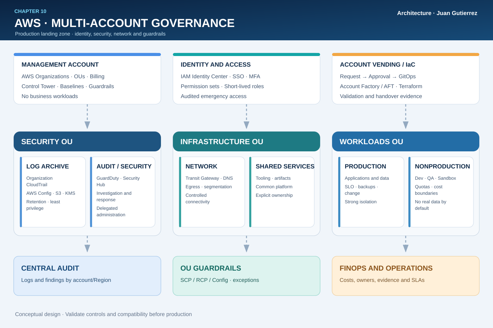

# 10 · The Cloud Organization: production-grade multi-account governance on AWS

**Author:** Juan Gutierrez · AWS Production Architecture Series  
**Focus:** AWS Organizations, AWS Control Tower, identity, preventive guardrails, centralized audit, automation, and operational accountability.

> Scaling AWS is not about multiplying accounts without controls. It is about defining trust boundaries, delegating decisions, and proving that every account is provisioned, operated, and retired under testable rules.

## 1. Scenario: a single account is no longer an adequate boundary

An organization runs customer-facing applications, analytics, development environments, and shared services on AWS. Product teams need autonomy, while leadership requires production isolation, traceability, temporary access, product-level cost ownership, and coordinated incident response. A single account makes too many roles, quotas, resources, and security changes share one blast radius. Multiple accounts help, **but an ungoverned account structure merely distributes the disorder**.

My design uses a multi-account *landing zone*: **AWS Organizations** defines the organization, **AWS Control Tower** provides managed baselines and controls where appropriate, **IAM Identity Center** federates workforce access, dedicated security accounts separate duties, and a controlled account-vending pipeline establishes repeatability.

### Requirements and acceptance criteria

| Goal | Architecture decision | Required evidence |
|---|---|---|
| Isolation | Production and nonproduction in separate accounts | Account, OU, and owner inventory |
| Identity | Workforce SSO, MFA, and least privilege | Assignments, access reviews, session records |
| Security | Centralized logs and delegated detection services | Test event delivered to the audit account |
| Governance | OU guardrails without disrupting critical services | Deny tests and documented exceptions |
| Resilience | Emergency access and account recovery | Documented break-glass exercise |
| Cost accountability | Account ownership, tags, and budgets | Allocation report and unallocated percentage |
| Operations | Reproducible account onboarding and retirement | Approved PR, pipeline, evidence, rollback |

Agree on regulatory requirements, approved Regions, and the control catalog before provisioning.

## 2. Reference architecture



**Reading the diagram:** the management account owns the organization and consolidated billing, but does not host business workloads. The **Security OU** contains *Log Archive* and *Audit/Security Tooling* accounts; **Infrastructure OU** holds network and shared services; **Workloads OUs** isolate production and nonproduction. Identity Center provides workforce access, and an IaC pipeline requests accounts, applies baselines, and records evidence. Logs, findings, and costs flow to central functions while teams operate their accounts with constrained roles.

The illustration shows **governance responsibilities and flows**, not the application's packet path or an automatically deployed stack.

## 3. Organizational units: group by control requirements, not org chart

| OU / account | Responsibility | Operating rule |
|---|---|---|
| Management account | Organizations, billing, privileged administration | No business workloads; highly restricted access |
| Security / Log Archive | Central CloudTrail and other log storage | Authorized ingestion; tightly controlled reads |
| Security / Audit | Delegated security administration and investigations | Separate investigators from application operators |
| Infrastructure / Network | Connectivity, DNS, egress, shared inspection | Reviewed changes and documented routes |
| Infrastructure / Shared Services | Shared tooling and artifacts | Explicit owners and cost allocation |
| Workloads / Production | Customer workloads and sensitive data | Stronger controls and formal change windows |
| Workloads / Nonproduction | QA, testing, and development | Cost boundaries and reduced production-data access |
| Sandbox | Time-limited experimentation | Budgets, restrictions, and automated cleanup |
| Suspended / Quarantine | Retired or investigated accounts | Restrict ordinary changes and preserve evidence |

**Design choice:** OUs group accounts that need similar policies. Avoid one OU per microservice, and never move accounts between OUs without evaluating inherited guardrails and baselines.

## 4. Guardrails: permissions, limits, and resource boundaries

**IAM** grants identity permissions. **AWS Organizations SCPs** place maximum-permission boundaries on principals in member accounts. **An SCP never grants access**, and SCPs do not constrain the management account in the same way. **RCPs** add boundaries for supported resources but also grant no permissions. Effective authorization depends on the intersection of policies and documented service-specific exceptions.

Controls worth evaluating include preventing CloudTrail/Config shutdown, restricting unapproved Regions, enforcing encryption, and reducing public exposure where supported. **Never roll out a blanket Deny without testing** deployments, managed services, emergency roles, and Control Tower baselines.

| Mechanism | Primary use | Does not replace |
|---|---|---|
| SCP | Preventive boundaries for member accounts and OUs | IAM and resource policy design |
| RCP | Resource access boundaries for supported services | Network controls, encryption, IAM authorization |
| Control Tower controls | Preventive, detective, or proactive governance | Application-specific security engineering |
| AWS Config | Configuration evidence and evaluation | Universal prevention or threat detection |
| IAM Identity Center | Workforce access with permission sets | Machine identities and emergency access |

**Managed landing-zone resources have owners:** modifying Control Tower-managed baselines outside supported workflows can cause drift.

## 5. Workforce identity, machine identity, and emergency access

For people, use **IAM Identity Center** with the corporate identity provider, MFA, and governed groups. Permission sets express functions such as `ReadOnly`, `DeveloperNonProd`, `PlatformOperator`, and `SecurityAuditor`. Review assignments regularly and prefer time-bound privileged access where the operating model supports it.

For workloads, use IAM roles and short-lived credentials; for CI/CD, prefer OIDC federation over persistent access keys when supported. The management account needs a separate, tested, audited recovery path. **Break-glass** does not mean a shared permanent admin user without MFA: document custodians, authentication, alerting, duration, and revocation.

Delegated administrators can manage supported services from member accounts, but **not every management-account privilege is delegable**.

## 6. Organization-wide security and observability

1. **Audit:** configure an organization CloudTrail trail with a protected central destination, encryption, retention, minimal access, and delivery tests; supplement with AWS Config and workload logs as required.
2. **Detection:** use services such as Amazon GuardDuty and AWS Security Hub CSPM with delegated administration; validate account and Region coverage, and establish triage ownership.
3. **Investigation:** keep Audit separate from workload operators; document evidence retention, chain of custody, and query access.
4. **Response:** isolate resources through approved runbooks rather than indiscriminate automation that may take production offline.
5. **Coverage:** validate newly created accounts, secondary Regions, and transitional accounts; a green dashboard does not prove all sources are onboarded.

**Common failure mode:** findings are centralized, but ownership and response times are not. Every critical alert should include account, resource, service owner, severity, runbook, and escalation route.

## 7. Networking and data: shared services are not implicit trust

A network account may host Transit Gateway, Route 53 Resolver, DNS, and controlled egress, depending on connectivity needs. VPC connectivity must not become lateral authorization: enforce segmentation, explicit routes, Security Groups, justified inspection, and workload-specific policies. Account isolation does not replace encryption, key management, or data classification.

For regulated workloads, assess residency, log exports, cross-Region access, and replication before centralizing everything in one location. Record shared-network dependencies: a failure in a central plane can affect many accounts simultaneously.

## 8. Account vending as a platform product

**Proposed workflow:** account request → owner and cost center → approval → destination OU → creation/enrollment → baseline → identity and logging → guardrails → compliance test → handover. Maintain an inventory of account owners, root emails, emergency contacts, and closure procedures.

**AWS Control Tower Account Factory** supports provisioning within the landing zone; **Account Factory for Terraform (AFT)** adds GitOps-based requests and customization when the additional complexity is justified. Do not mix manual edits and automation for the same managed resources without an ownership contract. For an existing landing zone, validate its version, enabled integrations, and enrollment behavior before migration.

An account is not production-ready merely because it appears in Organizations: **prove** logging, access, guardrails, tags, alarms, backups, and ownership.

## 9. Architecture decisions and trade-offs

| Decision | Benefit | Cost or risk |
|---|---|---|
| Control Tower over Organizations | Managed baselines and controls | Compatibility requirements and version changes |
| Organizations without Control Tower | Flexibility for highly customized environments | More platform engineering and custom evidence |
| Accounts by environment and product | Isolation of limits, ownership, and costs | More inventory, networking, and automation |
| Central network account | Consistent policies and visibility | Shared dependency and operational bottleneck |
| Federated Identity Center | Centralized workforce access lifecycle | IdP dependency and need for break-glass |
| AFT / GitOps | Reproducible and auditable account vending | Pipelines, state, and highly privileged roles |

I favor a **small, governed landing zone that evolves in stages**—not hundreds of SCPs or an OU hierarchy nobody can maintain.

## 10. Operating model and FinOps

Define a **RACI**: platform owns the landing zone and baselines; security approves exceptions and oversees findings; each product team owns its resources, vulnerabilities, and budgets; finance validates allocation and shared expenses.

Track baseline compliance per account, CloudTrail/Config coverage by Region, age of privileged assignments, accounts without owners, expired exceptions, critical findings past SLA, and unallocated costs. Shared networking, logging, and security expenses need an explicit allocation policy, not an invisible overhead bucket.

## 11. Terraform: an unattached guardrail by default

The [terraform](./terraform/) folder includes a sample **unattached SCP** protecting audit logging in member accounts. `terraform plan` previews the policy creation; by default it **does not attach to any OU**. Attachment requires an explicit opt-in and target OU.

```bash
cd terraform
terraform init
terraform fmt -check
terraform validate
terraform plan
# Do not run apply without governance-team approval.
```

**Scope:** requires Organizations permissions and SCPs enabled; it does not install Control Tower, create accounts, protect the management account, or replace an exception strategy. Before attachment, test in a lab OU and evaluate managed-service interactions.

## 12. Production readiness checklist

- [ ] Inventory of accounts, OUs, owners, classifications, and emergency contacts.
- [ ] MFA, protected root email, and account recovery procedures verified.
- [ ] Identity Center assignments and emergency access exercised.
- [ ] Organization trail and security sources tested for newly created accounts.
- [ ] Guardrails validated in a lab, with exception and rollback procedures.
- [ ] Regions, networking, and data boundaries reviewed by security and compliance.
- [ ] Account onboarding/retirement, OU moves, and baseline recovery tested.
- [ ] Budgets, tags, and shared costs assigned to accountable owners.
- [ ] Incident exercise: compromised member account escalated to Audit.
- [ ] `terraform validate` evidence, reviewed plan, and approval before `apply`.

### Failure scenarios for a game day

**A.** An operator attempts to stop CloudTrail in a member account: verify denial without breaking ingestion. **B.** The identity provider is unavailable: exercise emergency access and subsequent revocation. **C.** A new account does not deliver findings: detect the coverage gap before handover. **D.** An account moves between OUs: verify effective policy changes and possible drift.

## 13. Official AWS references

- [AWS Organizations — overview](https://docs.aws.amazon.com/organizations/latest/userguide/orgs_introduction.html)
- [Service control policies (SCPs)](https://docs.aws.amazon.com/organizations/latest/userguide/orgs_manage_policies_scps.html)
- [Resource control policies (RCPs)](https://docs.aws.amazon.com/organizations/latest/userguide/orgs_manage_policies_rcps.html)
- [AWS Control Tower](https://docs.aws.amazon.com/controltower/latest/userguide/what-is-control-tower.html)
- [Account Factory for Terraform (AFT)](https://docs.aws.amazon.com/controltower/latest/userguide/aft-overview.html)
- [IAM Identity Center permission sets](https://docs.aws.amazon.com/singlesignon/latest/userguide/permissionsets.html)
- [Organization trails in AWS CloudTrail](https://docs.aws.amazon.com/awscloudtrail/latest/userguide/creating-trail-organization.html)
- [AWS Well-Architected Security Pillar](https://docs.aws.amazon.com/wellarchitected/latest/security-pillar/welcome.html)

---

*AWS Production Architecture Series · Juan Gutierrez · Chapter 10 · Multi-account governance · Security · Operations · FinOps · Infrastructure as Code.*
