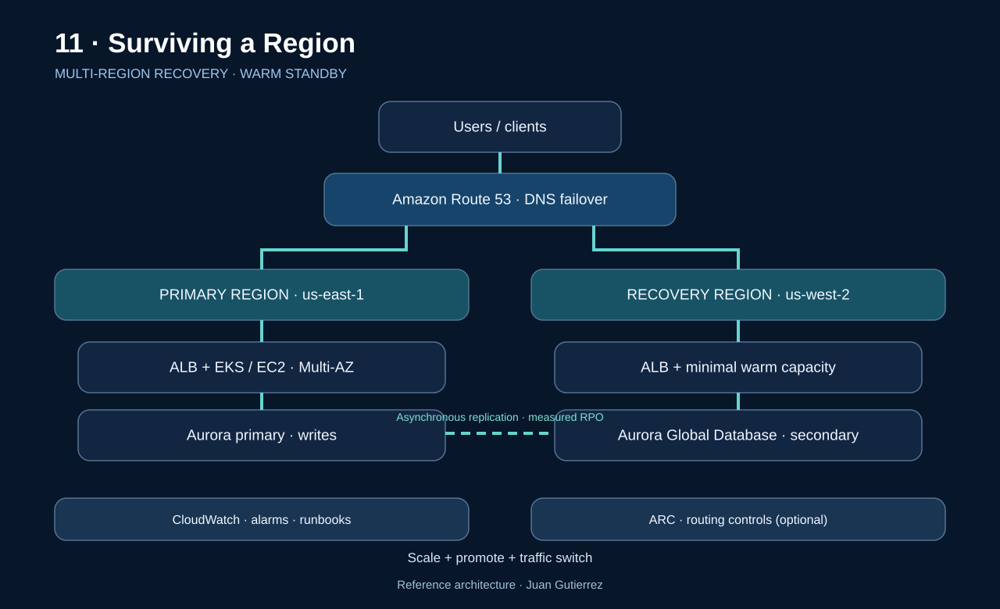

# 11 · Surviving a Region: production-grade multi-Region disaster recovery on AWS

**Author:** Juan Gutierrez · AWS Production Architecture Series  
**Date:** 2026-11-08

> Multi-AZ high availability does not equal survival of a Regional outage. Resilience starts with defining what must survive, how much data loss is acceptable, and who authorizes failover.

## Scenario and measurable objectives

An order-and-payment API uses ALB, EKS, and Aurora in us-east-1 across at least two AZs. It must recover in us-west-2 during a Regional impairment. The figures below are illustrative business targets, not AWS guarantees:

| Indicator | Design target | How to prove it |
|---|---|---|
| RTO | ≤ 30 min | Time from incident declaration to successful transactions |
| RPO | ≤ 5 min | Compare last acknowledged commit with recovered records |
| Availability | 99.95% monthly | External SLI for critical user journeys |
| Integrity | No duplicate charges | Idempotency and reconciliation tests |

RTO is the maximum tolerable time to restore service; RPO is the maximum tolerable age of recovered data. Agree both per business process rather than inferring them from a product name.

## Reference architecture



**Chosen pattern:** active/passive warm standby. The secondary Region keeps networking, security controls, baseline services, and minimum capacity ready to scale; Aurora Global Database replicates asynchronously. Route 53 routes clients to the active Region; ARC routing controls are optional for critical workloads.

### Normal operation and recovery

1. Clients resolve DNS to the primary ALB; the application writes only to the Aurora writer.
2. Cross-Region replication is asynchronous: lag and loss of the latest acknowledged writes are possible.
3. CloudWatch detects user-facing symptoms; the team declares the incident and determines whether failover is appropriate.
4. Unsafe writes are fenced, the secondary is promoted using a rehearsed procedure, compute is scaled, and traffic is switched.
5. Orders, payments, queues, sessions, and external dependencies are verified before declaring recovery complete.

## Choosing the DR pattern

| Pattern | Relative cost | Recovery characteristics | Limitation |
|---|---|---|---|
| Backup & restore | $ | Hours; provision and restore | Higher RTO/RPO |
| Pilot light | $$ | Live data, application to start | Slower scale-up |
| Warm standby | $$$ | Minutes when rehearsed | Partial duplicate capacity |
| Active/active | $$$$ | Potentially less interruption | Write conflicts and complexity |

**Decision:** use warm standby when an RTO in tens of minutes and RPO in minutes justify the cost. Multi-AZ remains the first defense; add multi-Region only when the business impact analysis requires it.

## Critical decisions and risks

| Decision | Benefit | Risk and mitigation |
|---|---|---|
| Aurora Global Database | Regional replicas | Async lag; measure actual RPO and rehearse promotion |
| Route 53 failover | Managed routing | DNS caching and shallow checks; use end-to-end health |
| ARC routing controls | Failover guardrails | Extra cost and setup; test safety rules and endpoints |
| Secondary capacity | Lower RTO | Quota shortfall; reserve and test capacity |
| Queues/events | Decoupling | Duplicates; idempotency keys, DLQ, reconciliation |

Do not depend on the impaired Region for identity, secrets, artifacts, container images, DNS, certificates, deployment pipelines, or operational approvals. Distinguish control plane from data plane: recovery requiring new resource creation during an outage may miss the RTO.

## Security and data protection

- Use Regional KMS keys and least-privilege IAM; verify break-glass operator access independent of Regional SSO.
- Replicate secrets through an approved mechanism; test rotation, TLS certificates, and data residency boundaries.
- Keep CloudTrail, audit logs, AWS Config, and alerts accessible outside the impaired Region.
- Maintain isolated immutable backups: replication does not replace recovery from deletion or logical corruption.

## Observability, operations, and runbook

Monitor p95/p99 latency, 5xx errors, synthetic transaction success from both Regions, replication lag, endpoint health, queue backlog, and available DR capacity. Alerts need an owner, severity, dashboard, runbook, and decision threshold.

**Operational sequence:**

1. Declare the incident; record T0, impact scope, and incident commander approval.
2. Check replication state, consistency, and external dependencies; assess potential data loss.
3. Fence the old writer to prevent split-brain; promote the secondary DB using engine-specific guidance.
4. Scale EKS/EC2 in DR, verify actual readiness, and switch DNS/ARC.
5. Run synthetic transactions and payment reconciliation; declare recovery only when SLIs are met.
6. Treat failback as a separate change; never automatically reverse DNS without data reconciliation.

## Terraform: deployable example and scope

The `terraform/` directory configures only two DNS failover records and an HTTP(S) health check for an existing primary endpoint. It does **not** create VPCs, ALBs, EKS, Aurora, or perform promotion. Use your own hosted zone and endpoints; run `terraform plan` before `apply`.

```bash
cd terraform
terraform init
terraform fmt -check
terraform validate
terraform plan -var='zone_id=Z123456789EXAMPLE' -var='record_name=app.example.com' -var='primary_ip=203.0.113.10' -var='secondary_ip=198.51.100.20' -var='health_fqdn=health.example.com'
```

**Warning:** the IPs and hosted zone are placeholders; replace them with real targets. An HTTP 200 alone does not prove application health; include critical dependency checks. DNS switching may exceed the TTL because of resolver/client caches.

## FinOps and capacity planning

Budget standby compute, Aurora storage/replicas, inter-Region data transfer, Route 53/health checks, monitoring, and DR exercises. Keep only minimum capacity if measured scale-up meets RTO; assess capacity reservations/quotas and load tests in the secondary Region.

## Production validation

- [ ] Approved BIA, service-level RTO/RPO, and failover owners
- [ ] Timed Regional failure exercise with RPO evidence
- [ ] Database promotion and fencing tested without split-brain
- [ ] Capacity, quotas, images, and secrets available in DR
- [ ] Alarms, synthetic health, DNS, and runbook validated
- [ ] Payment integrity, idempotency, backups, and restore verified
- [ ] Costs and data residency approved

## Official AWS references

- [Disaster Recovery of Workloads on AWS](https://docs.aws.amazon.com/pdfs/whitepapers/latest/disaster-recovery-workloads-on-aws/disaster-recovery-workloads-on-aws.pdf)
- [AWS multi-Region decision framework](https://docs.aws.amazon.com/prescriptive-guidance/latest/security-reference-architecture/multi-region-architecture.html)
- [Amazon Application Recovery Controller](https://docs.aws.amazon.com/r53recovery/latest/dg/what-is-route53-recovery.html)
- [Route 53 DNS failover](https://docs.aws.amazon.com/en_en/Route53/latest/DeveloperGuide/dns-failover-types.html)
- [Database RTO/RPO guidance](https://docs.aws.amazon.com/prescriptive-guidance/latest/strategy-database-disaster-recovery/choosing-database.html)

---

*Juan Gutierrez · AWS Production Architecture Series · Production architecture*
