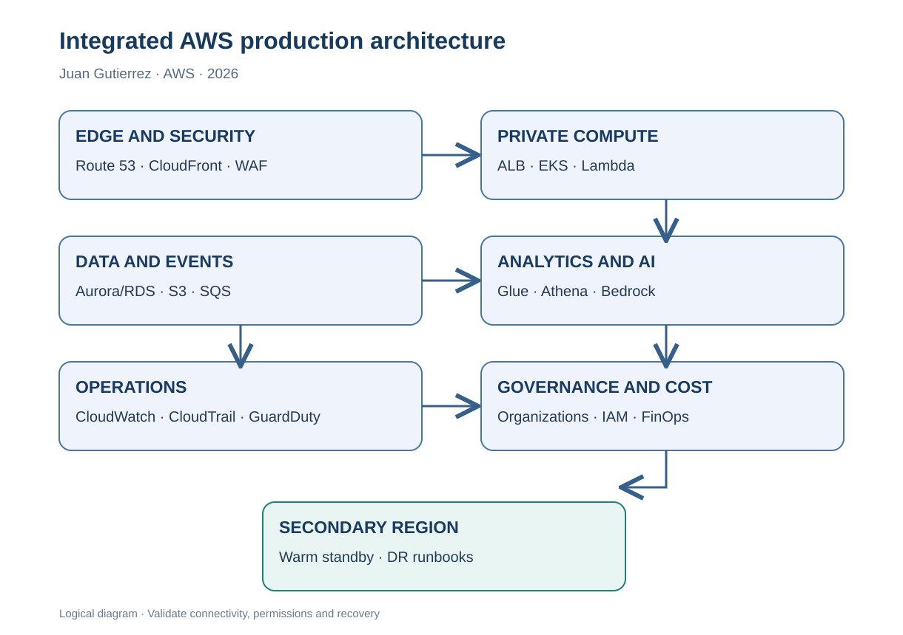

# 12 · The Final Architecture — An AWS system ready for production

**Author:** Juan Gutierrez · AWS Production Architecture Series · Final chapter

> Production architecture is not a collection of services. It is a set of testable decisions about security, resilience, performance, operations, and cost.

## Scenario and objectives

A regional digital platform processes transactions, serves APIs, runs asynchronous workflows, and offers AI-assisted search. It needs separation of teams and environments, auditing, failure recovery, repeatable deployment, and product-level cost visibility.

**Illustrative targets, not guarantees:** 99.95% monthly availability for critical APIs; p95 below 400 ms for synchronous routes; 5-minute RPO and 60-minute RTO for the transactional service under a regional outage, subject to testing. Agree on budget, data residency, and data classification before selecting services.

## Reference architecture



*Reference diagram: arrows show logical flows, not automatically configured network connectivity.*

### Request and data paths

1. **Edge and protection:** Route 53 resolves domains; CloudFront distributes content; AWS WAF inspects requests; ALB routes to private HTTP services. Shield Standard offers baseline DDoS protection but does not replace abuse testing.
2. **Compute:** Amazon EKS hosts services that genuinely require orchestration; Lambda handles events and bounded-duration tasks. API Gateway is an option for managed APIs, not a mandatory layer before every ALB.
3. **State and integration:** Aurora/RDS Multi-AZ stores transactions; S3 stores objects; EventBridge, SQS, and Step Functions decouple workflows. Engineer idempotency, dead-letter queues, backpressure, and concurrency limits.
4. **Analytics and AI:** S3 and Glue feed governed analytics using Lake Formation and Athena. Bedrock retrieves only authorized knowledge with identity-aware filters; it never receives implicit access to the entire transactional database.
5. **Operations:** CloudWatch and OpenTelemetry capture telemetry; CloudTrail and Config provide audit and configuration history; GuardDuty and Security Hub aggregate security findings.
6. **Continuity:** Multi-AZ primary region plus selective warm standby in a secondary region and explicit failover/failback procedures. Asynchronous replication can lose recent writes.
7. **Governance and cost:** Organizations, Control Tower, IAM Identity Center, SCPs, and separate accounts; tags, Cost Explorer, Budgets, and CUR 2.0 support showback and FinOps decisions.

## Architecture decisions and trade-offs

| Decision | Rationale | Cost or alternative |
|---|---|---|
| Multi-account separation | Isolation and smaller blast radius | More governance; automate account lifecycle |
| EKS only when Kubernetes is warranted | Deployment portability and control | Operational overhead; ECS/Fargate or Lambda may be simpler |
| Aurora/RDS Multi-AZ for transactions | Zonal high availability | Not regional DR; assess Global Database and backups |
| EventBridge/SQS integration | Burst tolerance and decoupling | Eventual consistency, deduplication, idempotency |
| Bedrock with authorized retrieval | Grounded responses and controlled access | Quality evaluation, token cost, prompt-injection threats |
| Selective warm standby | Faster recovery than backup/restore | Recurring expense; rehearse promotion and failback |
| IaC and preventive controls | Reviewable, reproducible changes | Incorrect policies can block legitimate operations |

## Security and privacy by design

- **Identity:** federated workforce access with IAM Identity Center, MFA and short-lived roles; least-privilege workload roles; no unjustified public access.
- **Network:** private subnets, narrowly scoped security groups, VPC endpoints where useful, controlled egress, documented routing and DNS dependencies.
- **Data:** TLS, encryption at rest with KMS where appropriate, secret rotation, classification, retention, deletion, and no sensitive payloads in logs or prompts.
- **Supply chain:** image scanning, pinned dependencies, artifact provenance, Terraform reviews, progressive deployment and rollback.
- **AI:** treat retrieved documents as untrusted input; enforce identity-based authorization and evaluate leakage, factual quality, and unsafe output.

## Reliability and disaster recovery

Multi-AZ redundancy protects against zonal failures; it does not guarantee continuity during a regional outage. Maintain independently recoverable backups, restoration drills, and a failover plan with activation criteria, owners, and communications. Account for regional dependencies such as identity, keys, queues, DNS, certificates, secrets, and compute capacity. Never claim RTO/RPO without measuring them.

**Minimum game day:** inject service degradation, confirm SLO-based alerting, execute rollback, restore data into an isolated environment, measure recovery objectives, and record improvements. For regional DR, test failback and prevent dual writers.

## Observability and incident response

Instrument RED metrics (rate, errors, duration), saturation, correlated traces, and structured logs with request IDs. Every actionable alert needs an owner, customer impact, dashboard, runbook, and escalation path. Confirm telemetry remains available during partial outages.

## FinOps and operational sustainability

Define cost centers and mandatory tags, budget thresholds, idle-resource reviews, rightsizing, and retention policies. Evaluate Savings Plans only after observing stable utilization. Include regional standby, data transfer, telemetry, NAT, Bedrock inference, and analytics queries. Optimize **cost per useful transaction**, not just total spend.

## Phased delivery plan

1. **Foundation:** accounts, guardrails, identity, centralized logging, and network baseline.
2. **Minimum product:** secure edge, one service, state, and CI/CD with rollback.
3. **Resilience:** Multi-AZ exercises, restorable backups, operational SLOs.
4. **Integrations:** messaging, analytics, and AI with data controls.
5. **Regional DR:** warm standby, runbooks, game days, measured RTO/RPO.
6. **Optimization:** capacity planning, continuous security, FinOps, postmortems.

## Safe Terraform example

The [terraform](./terraform/) directory contains a **demonstration baseline**: a CloudWatch Logs group with configurable retention and tags. It does not create EKS, RDS, networking, or production guardrails. AWS credentials and CloudWatch Logs permissions are required.

```bash
cd terraform
terraform init
terraform fmt -check
terraform validate
terraform plan -var='environment=dev'
```

Do not run `terraform apply` without reviewing account, region, permissions, cost, and plan. A full platform should separate modules, remote state, pipelines, and environment approvals.

## Production readiness checklist

- [ ] Business-approved SLOs, SLIs, budgets, and owners
- [ ] Accounts, roles, secrets, and encryption reviewed
- [ ] Load tests, quotas, and scaling behavior documented
- [ ] Backup restoration and DR tested with measured RTO/RPO
- [ ] Logs, metrics, traces, alerts, and runbooks operational
- [ ] Threat modeling, security tests, and change control complete
- [ ] Reviewed IaC, rehearsed rollback, and cost allocation tags
- [ ] AI evaluation, authorization, and privacy checks completed

## Official AWS references

- [AWS Well-Architected Framework](https://docs.aws.amazon.com/wellarchitected/latest/framework/welcome.html)
- [AWS Organizations](https://docs.aws.amazon.com/organizations/latest/userguide/orgs_introduction.html)
- [Amazon EKS](https://docs.aws.amazon.com/eks/latest/userguide/what-is-eks.html)
- [Amazon EventBridge](https://docs.aws.amazon.com/eventbridge/latest/userguide/eb-what-is.html)
- [Amazon Bedrock](https://docs.aws.amazon.com/bedrock/latest/userguide/what-is-bedrock.html)
- [Disaster Recovery on AWS](https://docs.aws.amazon.com/whitepapers/latest/disaster-recovery-workloads-on-aws/disaster-recovery-workloads-on-aws.html)
- [Amazon CloudWatch](https://docs.aws.amazon.com/AmazonCloudWatch/latest/monitoring/WhatIsCloudWatch.html)
- [AWS Cost Management](https://docs.aws.amazon.com/cost-management/latest/userguide/what-is-costmanagement.html)

---

**Juan Gutierrez** · AWS Production Architecture Series · Security · Resilience · Observability · FinOps · IaC